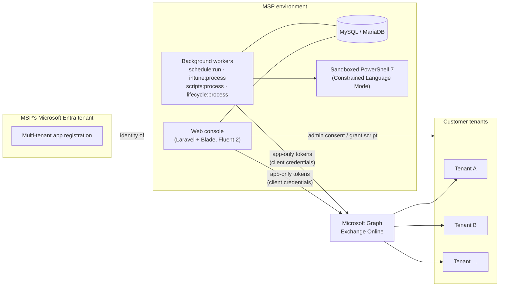

<div align="center">

# TenantsGuard

**Multi-tenant Microsoft 365 and Intune security console for managed service providers**

Assess, harden, automate and prove security across every customer tenant from one console,
with least-privilege access to each tenant.


[Features](#features) · [Architecture](#architecture) · [Security](#security-model) · [Quick start](#quick-start) · [Configuration](#configuration) · [User guide](docs/USER-GUIDE.md)

</div>

---

## Overview

TenantsGuard connects to customer Microsoft 365 tenants through **one multi-tenant Microsoft Entra app** that the MSP owns. Customers grant consent once. After that, technicians can:

- **Scan** each tenant against a library of security controls and map the results to compliance frameworks.
- **Fix** gaps one at a time or across many tenants, with safe defaults. For example, Conditional Access policies are always created in report-only mode first.
- **Deploy** Zero Trust Intune baselines and run identity lifecycle tasks: onboarding, offboarding and guest clean-up.
- **Run** structured programmes for Microsoft Purview and Microsoft 365 Copilot, from requirements to production.
- **Run** approved PowerShell scripts against any selection of tenants, in a sandbox.
- **Prove** results with white-label reports, drift tracking and a full audit trail.

It is built with Laravel 12 and server-rendered Blade, and the interface follows Microsoft Fluent 2. There is no front-end build step. It runs on a plain PHP and MySQL stack, including XAMPP on Windows.

> **Try it without Azure.** Click **Add demo tenant** to get a simulated, deliberately weak tenant. Every module works against it, including fixes, drift, deployments, scripts and reports.

## Features

| Module | What it does |
|---|---|
| **Security posture** | 33 controls per tenant via Microsoft Graph and DNS: MFA and Conditional Access, privileged roles, app consent, guests and sharing, SPF/DKIM/DMARC, devices and Secure Score. Licence-aware (P1/P2/Intune), severity-weighted score, drift detection and a 120-day trend. |
| **Client dashboard** | Overview of users, MFA, authentication methods, licences and devices. Identity and device test views with evidence and remediation, people search across clients, and links to every admin portal. |
| **Compliance and control plans** | Essential Eight (ML1–3), ASD ISM, HIPAA, CIS M365 / Controls v8.1, NIST CSF 2.0 / 800-53, ISO 27001, PCI DSS and Cyber Essentials. Plans are de-duplicated, phased, applied and monitored per client; manual evidence is recorded as attestations. |
| **Microsoft Secure Score** | Score history, peer comparison, and improvement actions linked to the TenantsGuard control that fixes them. |
| **Intune** | 30 Zero Trust templates for Windows, iOS/iPadOS and Android, plus 5 prebuilt bundles. Licence-fit preview, idempotent `TG -` naming and pilot-group assignment. Deployments run in a background worker with live progress. |
| **Identity management** | Users, groups and guests. Single, bulk (CSV) and scheduled onboarding with Temporary Access Pass and user templates. Offboarding that locks out the user, hands over mailbox and ownership, retires or wipes devices, and reclaims licences. |
| **Microsoft Purview** | Requirements workshop, then a licence-aware design (labels, DLP, retention, insider risk), an approval gate, a phased checklist, generated idempotent PowerShell, verification and client-ready documents. |
| **Microsoft 365 Copilot** | Readiness assessment, prerequisites and oversharing remediation, a gated pilot, rollout waves with licence guard rails, adoption reviews and documents. |
| **PowerShell scripts** | Versioned scripts with four-eyes approval, run against any selection of tenants in a sandbox. Results stream live. |
| **Permission scope** | Capability-based, least-privilege access per client: an app plan, an access profile per client and a live check of what each client granted. Includes a grant/revoke script and time-limited Tier 0 access. |
| **Reports** | White-label executive report (PDF), delta report between any two scans, and an Excel workbook. |
| **Operations** | Per-client locking, alerts to Teams, Slack or a webhook, a system health view, and CSV audit export. |

See the **[user guide](docs/USER-GUIDE.md)** for a walkthrough of each module.

## Architecture



- **One app, many tenants.** Each request uses an app-only token for one specific tenant. TenantsGuard never stores customer passwords. A customer can revoke access at any time by deleting the enterprise application.
- **Policy before every write.** All Graph writes, for real and demo tenants alike, pass a per-client access policy. Writes that aren't mapped to a capability are refused (default deny).
- **Long-running work runs in the background.** Workers handle scans, Intune deployments, script runs and scheduled lifecycle tasks. Changing operations take a per-client lock.
- **Demo mode.** A mock Graph client and a mock DNS resolver simulate a full tenant, so the product and the test suite run without Azure.

## Security model

TenantsGuard holds powerful access to customer tenants, so the design follows a least-privilege, defence-in-depth approach:

| Layer | Controls |
|---|---|
| **Console access** | Mandatory TOTP MFA for every account, single-use codes and recovery codes. Optional Microsoft sign-in. Rate limiting, and sessions revoked when a user is disabled or their MFA is reset. |
| **Staff authorisation** | Role-based permissions (Global Administrator, Administrator, Technician, Read-only, custom roles), per-user tenant scoping, and safeguards for the last Global Administrator. |
| **Tenant permissions** | Capabilities in three tiers: read, write and privileged (Tier 0). Every client has its own access profile, and new clients start without Tier 0. Enabling Tier 0 needs a Global Administrator, a justification and optionally an expiry. A generated script grants exactly the enabled permissions and revokes the rest. Over-granted clients are flagged. |
| **Change safety** | Report-only Conditional Access first, previews before deployments, typed confirmations for destructive actions, and step-up MFA for change scripts. |
| **Script sandbox** | HMAC-signed approvals and four-eyes review. Scripts run under Constrained Language Mode with a scrubbed environment, receive tokens only over STDIN, and have output redacted. Time, output and API-call budgets apply, and a kill switch is available. |
| **Secrets** | The app secret is encrypted at rest. Tokens never reach logs or disk. `.env` is excluded from version control. |
| **Accountability** | Full audit trail (who, what, tenant, outcome, detail) with CSV export and alerting. |

See [SECURITY.md](SECURITY.md) for how to report a vulnerability and how to harden a production deployment.

## Quick start

### Requirements

| Component | Version | Notes |
|---|---|---|
| PHP | 8.2+ | Extensions: `pdo_mysql`, `openssl`, `mbstring`, `curl`, `fileinfo`, `iconv`, `gd`, `zip` and the XML extensions (`dom`, `xml`, `xmlreader`, `xmlwriter`, `simplexml`). XAMPP includes them all; `gd` and `zip` may need enabling in `php.ini`. |
| Composer | 2.x | |
| MySQL / MariaDB | MySQL 8 / MariaDB 10.4+ | XAMPP's MariaDB works |
| PowerShell 7 | optional | Needed for the PowerShell scripts module. Install the `Microsoft.Graph.Authentication` and `ExchangeOnlineManagement` modules. |

### Install

```bash
git clone https://github.com/getakter/TenantsGuard.git
cd TenantsGuard
composer install
cp .env.example .env            # Windows: copy .env.example .env
php artisan key:generate
```

Create the database. With XAMPP on Windows:

```powershell
C:\xampp\mysql\bin\mysql.exe -uroot -e "CREATE DATABASE IF NOT EXISTS tenantsguard CHARACTER SET utf8mb4 COLLATE utf8mb4_unicode_ci"
```

Set `DB_*` and a strong `ADMIN_PASSWORD` in `.env`, then migrate and seed. Seeding creates the first Global Administrator, the default baselines, the Intune bundles and the sample scripts:

```bash
php artisan migrate --seed
php artisan serve
```

Open **http://localhost:8000**, sign in with `ADMIN_EMAIL` and `ADMIN_PASSWORD`, and register an authenticator app when prompted.

### Run the background scheduler

Rescans, scheduled lifecycle tasks, and the safety net for background workers all need the Laravel scheduler running every minute.

- **Development:** `php artisan schedule:work`
- **Windows (production):** create a Scheduled Task that runs every minute:
  `C:\xampp\php\php.exe C:\path\to\TenantsGuard\artisan schedule:run`
- **Linux:** `* * * * * cd /path/to/TenantsGuard && php artisan schedule:run >> /dev/null 2>&1`

The **Settings > System health** page shows whether the scheduler is running.

### Connect Microsoft 365

1. **Create the app.** Go to **Settings > Microsoft app > Sign in with Microsoft to set up**. Sign in as a Global Administrator of *your own* tenant. TenantsGuard creates the multi-tenant app registration, its secret and the permissions in your app plan. Manual registration is also supported: see the [user guide](docs/USER-GUIDE.md#method-b-manual-registration).
2. **Choose the app plan.** Under **Monitor > Permission scope**, pick the capabilities your service offers, then select **Settings > Update app permissions**.
3. **Onboard a customer.** Use **Connect with Microsoft**: the customer's Global Administrator picks their account and clicks **Accept**. Alternatively, add the tenant by domain and send them the consent link.
4. **Apply least privilege.** On the client's **Access and permissions** page, choose a profile and download the grant script for the client's administrator to run. Then select **Check grant now**.

## Configuration

Settings are read from `.env`. Branding, the Microsoft app, sign-in tenants and alert channels can also be managed in the console under **Settings**. Values saved there take precedence.

| Key | Default | Purpose |
|---|---|---|
| `APP_URL` | `http://localhost:8000` | Base URL; used for redirect URIs. Microsoft only allows `http://` redirect URIs on `localhost`. |
| `ADMIN_NAME`, `ADMIN_EMAIL`, `ADMIN_PASSWORD` | — | First Global Administrator, created by `db:seed`. |
| `MS_CLIENT_ID`, `MS_CLIENT_SECRET` | — | Multi-tenant Entra app. Optional if you use automatic setup. |
| `MS_APP_NAME` | `TenantsGuard` | Display name of the app registration that automatic setup creates. |
| `SCAN_INTERVAL_HOURS` | `24` | Rescan tenants whose last scan is older than this. |
| `SCAN_RETENTION_DAYS` | `120` | Scan history kept. |
| `TG_INTUNE_DISPATCH` | `spawn` | `spawn`: start a background worker on submit. `scheduler`: wait for `schedule:run`. `sync`: run in the request (tests). |
| `TG_SCRIPTS_DISPATCH` | `spawn` | The same options for PowerShell script runs. |
| `TG_PWSH` | auto | Path to `pwsh.exe`. |
| `TG_SCRIPTS_MAX_TENANTS`, `TG_SCRIPTS_OUTPUT_KB`, `TG_SCRIPTS_RETENTION_DAYS` | `50`, `512`, `90` | Limits for script runs. |

### Production checklist

- [ ] `APP_ENV=production`, `APP_DEBUG=false`, served over HTTPS, with `APP_URL` set to the public URL.
- [ ] A dedicated low-privilege service account for the web server and workers.
- [ ] Scheduler configured (Scheduled Task or cron) and shown as healthy in **System health**.
- [ ] App credential rotated before expiry. Prefer a certificate over a client secret.
- [ ] Customers on the least-privilege grant script rather than full consent, with no unnecessary Tier 0 access.
- [ ] Outbound traffic from `pwsh.exe` restricted to Microsoft endpoints, if scripts are enabled.
- [ ] Database backups. The database holds the encrypted app secret and the audit trail.

## Project structure

```
app/
├── Console/Commands/      Scheduled and worker commands (tenants:scan, intune:process, scripts:process, lifecycle:process …)
├── Http/Controllers/      Web controllers, one per area
├── Models/                Eloquent models
├── Services/
│   ├── Access/            Per-client access policy and least-privilege grant script
│   ├── Checks/            Control catalogue, framework mappings, scan context
│   ├── Compliance/        Framework registry, control plans and plan runner
│   ├── Copilot/           Copilot programme: assessor, planner, scripts
│   ├── Dashboard/         Client overview and test library
│   ├── Demo/              Mock Graph client, mock DNS and demo tenant generator
│   ├── Graph/             Microsoft Graph client (paging, throttling, policy gate)
│   ├── Intune/            Template catalogue, deployer, inventory
│   ├── Lifecycle/         Onboarding, offboarding, directory
│   ├── Microsoft/         App registration provisioning
│   ├── Purview/           Purview programme: catalogue, designer, planner, scripts
│   └── Scripts/           PowerShell linter, executor and run service
└── Support/               Capabilities (Access), permissions, tenant lock, helpers
database/migrations/       Schema
resources/views/           Blade UI (no build step)
resources/powershell/      Sandbox runner for PowerShell scripts
public/css, public/js      Fluent 2 styles and console interactions
tests/Feature/             End-to-end feature tests against demo tenants
docs/USER-GUIDE.md         Detailed module documentation
```

## Testing

```bash
php artisan test
```

The suite uses in-memory SQLite and demo tenants, so it needs no Azure subscription or MySQL. If PowerShell 7 is installed, generated scripts are also parse-checked. Format code with `vendor/bin/pint`.

## Contributing

1. Fork the repository and create a feature branch.
2. Add or update tests in `tests/Feature`. New Graph endpoints also need support in `app/Services/Demo/MockGraphClient.php`.
3. New Graph write paths must be mapped to a capability in `app/Support/Access.php`. Unmapped writes are refused.
4. Run `vendor/bin/pint` and `php artisan test` before opening a pull request.

To add a security control, see [Adding a control](docs/USER-GUIDE.md#adding-a-control).

## Disclaimer

TenantsGuard is an independent project and is not affiliated with or endorsed by Microsoft. Framework mappings, retention periods and generated policies are expert guidance, not a certification. Validate them against the exact benchmark versions you report on, and test changes on a pilot group before broad rollout.

## License

No license has been chosen yet. Until one is added, all rights are reserved by the author.
